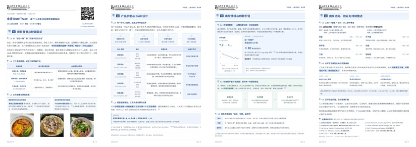

# 食迹 NutriTrace

**基于个人饮食台账的营养管理智能体**  
英文名：**NutriTrace** · 仓库：`project_ShiJi`

上海工程技术大学 2026「AI赋能·三旋翼驱动」旋创赛参赛项目 · 团队 **2的10次幂**

[在线体验](https://sa.zheoi.com/) · [在线项目书](https://sa.zheoi.com/docs/proposal.html) · [四页 PDF](docs/proposal.pdf) · [参考文献](docs/references.md)



## 项目介绍

面向经常吃食堂、外卖和便利店的成年青年，把餐食、实际食用量、偏好、精力自评和睡眠组织为个人历史，帮助回答“最近哪些食物来源比较少”“今天在预算内加什么”和“持续不适时怎样准备就医”。

| Skill | 任务 |
| --- | --- |
| 餐食解码 `meal_profile_skill` | 拍照或文字记餐，补充份量，修正记录并保留历史 |
| 营养雷达 `nutrient_radar_skill` | 按有来源的食物条目和份量计算，回顾摄入来源 |
| 身体线索 `body_signal_skill` | 整理精力、睡眠、不适持续时间与伴随表现 |
| 食补配餐 `food_repair_skill` | 按营养目标、预算和忌口比较有份量的加购方案 |
| 就医准备 `care_navigation_skill` | 整理持续不适线索与咨询问题，导出沟通摘要 |

## 演示范围

- 15 张照片组成可编辑的 7 天台账，支持筛选、修正、上传与导出。
- 另有两组 15 天标准化食材与身体自评情境，体验营养计算、配餐与就医准备。
- 9 个来源明确的 USDA 食物条目，计算维生素 C、叶酸和钙，支持预算及乳类排除条件。
- 可连接兼容 OpenAI Chat Completions 协议的模型 API，通过工具调用执行任务；不配置 API 仍可使用台账、计算与离线对话示例。

两套演示数据相互独立；日期、份量和身体自评为情境编排。“身体电量”表示本人精力自评，摄入估算不能诊断营养缺乏，就医准备不替代医生评估。正式 WorkBuddy 封装、中文食物库扩展及真实用户验证为后续工作。

## 本地运行

需要 **Node.js 22+**。服务端仅用 Node 内置模块，直接启动无需安装运行依赖。

```bash
git clone git@github.com:yangzhe0/project_ShiJi.git
cd project_ShiJi
npm start
```

打开 `http://127.0.0.1:8765/`。项目书：`/docs/proposal.html`，PDF：`/docs/proposal.pdf`。

需要实时 AI 时，把 `.env.example` 复制为 `.env`，填写自己的 API 地址、密钥与模型，再启动；也可直接传入环境变量。真实 `.env` 已忽略。Windows 可运行 `tools/start-local.ps1`，以隐藏输入方式临时提供密钥。

## 验证与项目书重建

```bash
npm test
npm install
npx playwright install chromium
python -m pip install -r requirements.txt
npm run build:proposal
```

网站启动后，可另开终端执行 `npm run test:ui`。使用本机 Chrome 时，通过 `CHROME_EXECUTABLE_PATH` 指定浏览器可执行文件。

正文与排版源是 `tools/build_proposal.py`，构建同步生成 HTML、四页 PDF、正文与参考资料。字体子集已附带；新增汉字时，设置 `SHIJI_SERIF_FONT` 和 `SHIJI_SANS_FONT` 为完整的 Noto Serif SC / Noto Sans SC 可变字体文件，运行 `python tools/build_proposal.py --fonts` 更新子集。

## 文件结构

```text
project_ShiJi/
├── demo/                   网页、交互、台账与营养计算
├── assets/                 餐食素材、学校标识、二维码与字体
├── docs/                   项目书、参考文献与部署说明
├── tools/                  构建、验证、启动与部署工具
├── agent.cjs               模型提示与工具调用
├── server.cjs              静态资源与 API 代理
├── index.html              项目资料导航页
├── project.config.json     项目、团队与体验入口配置
├── .env.example            无真实密钥的配置示例
└── package.json
```

报名表、签字确认书、学号、电话、邮件及历史草案不在仓库中。问卷星附件使用本地 `01_提交材料`，不需要上传整个源码仓库。

## 团队

| 成员 | 报名分工 |
| --- | --- |
| 杨哲 | 开发 / 设计，负责人 |
| 邱宇强 | 调研 / 分析 |
| 方子昊 | 调研 / 分析 |
| 白璐 | 管理 / 调研 |
| 江媛 | 设计 / 展示 |
| 张新成 | 设计 / 展示 |

指导教师：**许雪花讲师**。

顾问：张会彦（上海工程技术大学）、沈世勇（上海工程技术大学）、孙鼎（上海中医药大学龙华医院）、刘婧（上海健康医学院）。

第三方资料说明见 [THIRD_PARTY_NOTICES.md](THIRD_PARTY_NOTICES.md)；部署方式见 [docs/deployment.md](docs/deployment.md)。本仓库暂未指定统一开源许可证。
